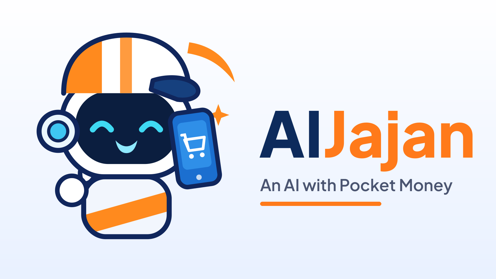

# AIJajan — an AI with pocket money · SERV Edition

> **Jajan** *(n.)* — Indonesian for spending your pocket money on little treats.

**AIJajan** gives an AI agent, **Jaja**, a weekly pocket-money allowance
(*uang jajan*) held in the **PayPal sandbox**. You give Jaja shopping
missions in plain words. Jaja scouts a catalog, picks what it wants, and
explains itself — but before a single cent moves, a **deterministic policy
engine** (plain code, *not* an LLM) checks your rules and answers
**ALLOW**, **ASK** (owner must approve), or **BLOCK**, always citing the rule
that decided it. Jaja cannot sweet-talk its way past the engine.

Along the way Jaja keeps a **diary** of its spending decisions, has a **mood**
driven by its balance, and when it goes broke it composes a heartfelt
**plea** for a top-up — which you may approve or deny. Everything lands in a
full **audit log**, and a **kill switch** can freeze Jaja instantly. All money
in the demo is PayPal **sandbox** money — no real funds ever move.

## SERV Edition — what's new

This repository is the **SERV Edition** of AIJajan, built for the **OpenServ
SERV Hackathon — Edition 02, Kite track** ("Build agents with a verifiable
identity and spending limits you control, so it can shop, book, and pay on
your behalf, safely."). The original app already had the spending limits;
what it was missing was a reasoning layer that **shows its work**. That is
what this edition adds:

- **SERV Reasoning is the planning brain** (`src/serv.js`). Every mission is
  planned by [SERV Reasoning](https://inference-api.openserv.ai)
  (`POST /v1/chat/completions`, default model `google/gemini-2.5-flash`):
  understand → scan → weigh → rules-preview → propose. The plan comes back
  as data: a reasoning **trace** (id `serv-…`) plus a ranked **proposal** in
  which every item carries its own reason — including SERV flagging risks
  itself, e.g. auto-renewing subscriptions.
- **The reasoning trace panel.** The UI renders each trace as a timeline of
  reasoning steps, a proposal → policy-verdict mapping with the rule cited
  per item, and an outcome banner (`paid` / `ask` / `blocked` / `no-match` /
  `payment-failed`). Traces persist server-side and are cross-referenced
  from the audit log by trace id, together with the SERV call's usage
  (model, tokens, latency, estimated cost) — the evidence SERV was really
  consulted.
- **Separation of powers, enforced in code.** SERV proposes and explains;
  it never decides. `src/serv.js` holds no reference to the payment client,
  and the server only pays for items the deterministic policy engine
  (`src/policy.js`) returned ALLOW for (or the owner approved after an
  ASK). And the owner's rules are **never sent to SERV**: during live
  probing, telling SERV "subscriptions are banned" made the gateway decline
  the mission itself, so the policy engine never ruled — a
  separation-of-powers leak. SERV receives the mission, the catalog, and
  the balance only, and is instructed to propose genuine fits and flag
  visible risks instead of pre-applying rules. Verdicts belong to the
  engine alone.
- **Safe fallback.** If SERV is unreachable, times out, or answers garbage,
  the built-in deterministic planner drafts the mission instead; the policy
  engine judges that plan identically, and the fallback is recorded in the
  trace and the audit log (`serv-fallback`). A planner outage can never
  become a spending spree. (Verified live: with a deliberately bogus API
  key the mission still completed, gated exactly the same way.)
- **Live-proven, not just mocked.** The adapter was verified against the
  real API on 2026-11-10: a nasi-goreng mission SERV proposed was ALLOWed
  and paid; a music-subscription proposal was BLOCKed by policy
  (`no-subscriptions`); "buy me a house" was honestly declined. Because the
  gateway's reply schema varied between calls, `normalizeServResponse()`
  extracts the plan structurally and validates every proposed id against
  the catalog — unverifiable entries are dropped, never invented.

See **[SERV-DESIGN.md](SERV-DESIGN.md)** for the full design, the live-probe
evidence, and the honest built-here vs. pre-existing split.

## A note on what is new vs. pre-existing

The base app — concept, Jaja's character, the policy engine, the PayPal
sandbox client, the 47-item catalog, the rules parser, the diary/plea voice,
the base UI, and the original 28 tests — was built earlier for the **PayPal
AI Hackathon** and is [open-sourced separately](https://github.com/Revaaa28/aijajan).
The SERV integration — `src/serv.js`, the mission-flow rewiring, the
reasoning trace panel, 14 new tests, and this edition's docs — was built
during the **SERV Hackathon, 10–16 November 2026**, as the OpenServ FAQ
allows for existing projects with a meaningful new feature.
[SERV-DESIGN.md §2](SERV-DESIGN.md) lists exactly which files are which;
`src/policy.js`, `src/paypal.js`, `src/catalog.js`, and
`src/rulesParser.js` are untouched — the law did not need amending to gain
a brain.

## What to try

1. **Small mission** — "Buy me a nasi goreng voucher" → SERV proposes, the
   engine says ALLOW (rule `within-limits`), Jaja pays on its own and
   writes a smug diary entry. Watch the plan appear in the trace panel.
2. **Big mission** — "Find me hosting for my portfolio website" → the price
   is above the auto-allow limit, so the engine says ASK (rule
   `ask-above-threshold`) and a permission card appears. Approve it and the
   PayPal payment fires.
3. **Forbidden fruit** — "Subscribe me to a music streaming premium plan" →
   SERV proposes the subscription (its own reason flags the auto-renew
   risk), and the policy engine BLOCKs it (rule `no-subscriptions`). Jaja
   files a formal complaint in its diary.
4. **Going broke** — spend Jaja down until the balance drops under $5 → the
   plea card appears. Approve the top-up or stay strong.
5. **Kill switch** — flip it and send any mission: rule `kill-switch`
   blocks everything, even a $2 item — and the trace shows every proposal
   being rejected.

## Architecture

```
  mission (plain words, EN/ID)
        │
        ▼
  ┌─────────────────────┐   plans + explains; returns DATA, never decisions
  │  SERV Reasoning     │   steps[]    — auditable reasoning trace
  │  (src/serv.js)      │   proposal[] — ranked items, each with a reason
  └─────────────────────┘
        │  every proposed item, one by one
        ▼
  ┌─────────────────────┐   deterministic code, NOT an LLM; cannot be
  │  Policy engine      │   sweet-talked, prompt-injected or bargained with
  │  (src/policy.js)    │   verdicts: ALLOW / ASK / BLOCK, rule cited
  └─────────────────────┘
        │  ALLOW, or ASK + owner approval
        ▼
  ┌─────────────────────┐   PayPal sandbox payouts (the agent-disbursement
  │  PayPal (sandbox)   │   rail: an autonomous agent has no human sitting
  │  (src/paypal.js)    │   at a checkout page to approve orders)
  └─────────────────────┘
```

```
public/            Single-page UI (no build step): mission input, live
                   decision feed, reasoning trace panel, approval & plea
                   cards, diary, audit log
server.js          Express API + tiny .env loader; mission flow: SERV
                   plans → policy judges each proposal → PayPal pays
src/serv.js        SERV Reasoning layer: planMission() -> { traceId, steps,
                   proposal, options, pick, pitch, noMatch }. Live API
                   transport (callServApi) + structural response
                   normalizer; deterministic mock engine behind SERV_MOCK.
                   No reference to the payment client, by design.
src/policy.js      The deterministic policy engine: evaluate(purchase, ctx)
                   -> { decision: ALLOW|ASK|BLOCK, rule, reason }
src/catalog.js     The "mall": 47 everyday listings (food, domains,
                   hosting, game vouchers, subscriptions, music, …)
src/agent.js       Jaja's voice: diary writer + plea composer (Gemini when
                   GEMINI_API_KEY is set, built-in templates otherwise);
                   also the deterministic fallback planner.
src/paypal.js      PayPal sandbox REST client (OAuth + Payouts API).
                   Agent purchases settle as payouts: an autonomous agent
                   has no human at a checkout page, so the policy engine is
                   the approval layer (Checkout capture would fail with
                   ORDER_NOT_APPROVED). Mock mode simulates everything.
src/store.js       JSON-file state: balance, policy, audit, diary, pending
                   approvals, plea, frozen flag, monthly spend per category,
                   last reasoning trace
src/rulesParser.js Teaches rules from plain language ("ask me first above
                   $15, no subscriptions, games max $20 a month") into the
                   structured fields below — deterministic, no LLM.
test/              42 node:test tests: policy engine, rules parser,
                   planner (28 pre-existing) + SERV client, trace shape,
                   separation-of-powers gating, end-to-end (14 new)
```

### The policy engine

Owner rules are structured fields — set either with the form in the UI or by
typing them in plain words ("Teach Jaja in plain
...[truncated 3396 chars]